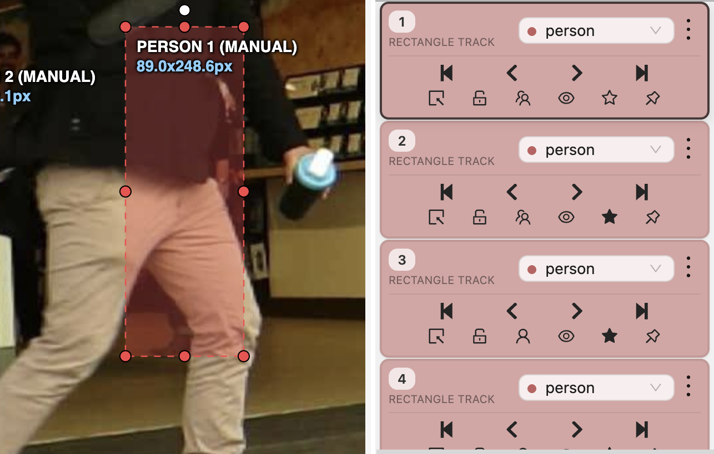
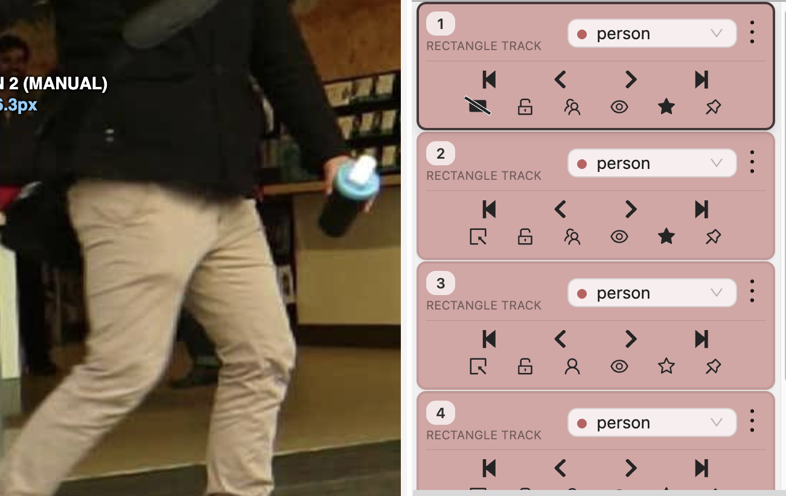
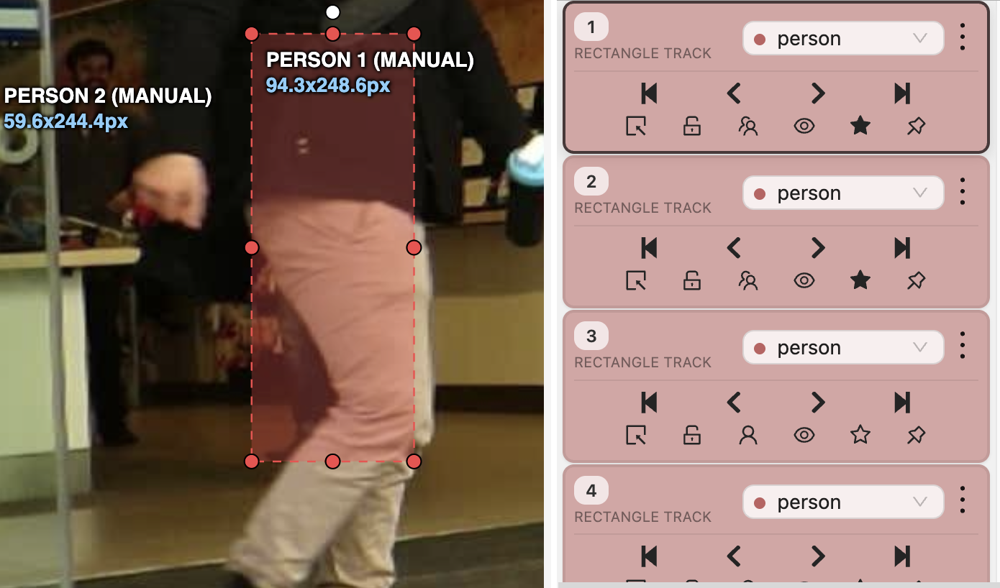
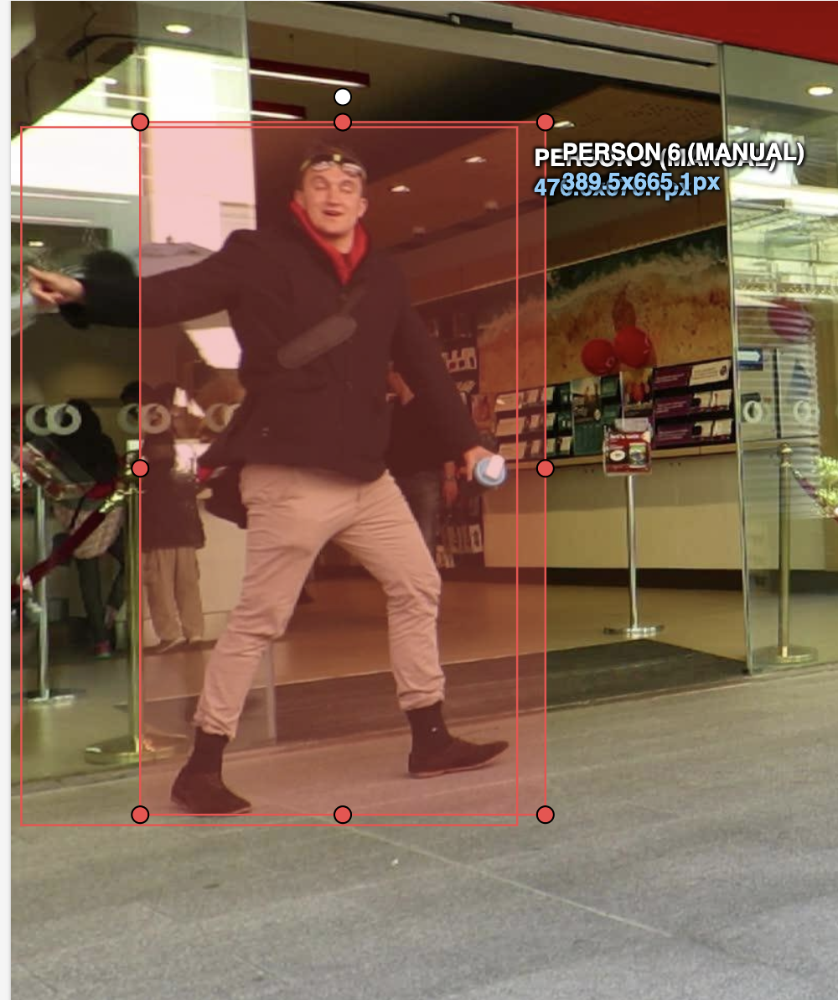

# Báo cáo cá nhân — PhamHuuHung-2A202603087

Đổi tên file theo quy tắc `MSSV_HoTen.md`. Ví dụ: `20241234_NguyenVanAn.md`.

Đoạn video: MOT17-09, 150 frame (frame 1–150), nguồn MOTChallenge (Milan et al., 2016), giấy phép CC BY-NC-SA 3.0.

## 0. Thông tin học viên

- Họ tên: Phạm Hữu Hưng
- MSSV: 2A202603087
- Mã đề (A/B/C): C
- Email: hwngt1412@gmail.com
- Link repository: https://github.com/hungtun/K5-L2-DAY05-PhamHuuHung-2A202603087-MOTTracking
- Giờ bắt đầu: 16:48
- Giờ kết thúc: 18:05

## 1. Xem trước đoạn video (CP0)

Ghi **trước khi vẽ**, mỗi người một dòng.

| Mã  | Frame xuất hiện (CVAT) | Frame cuối thấy được (CVAT) | Rẽ / dừng / đổi tốc độ ở frame                         | Bị che ở frame                                                                                | Ghi chú                                                                                                                        |
| --- | ---------------------: | --------------------------: | ------------------------------------------------------ | --------------------------------------------------------------------------------------------- | ------------------------------------------------------------------------------------------------------------------------------ |
| P1  |                      0 |                         149 | 8–13, 25, 33–39, 51–59, 67–72, 85–97, 101–121, 137–141 | Che một phần (`occluded`): 0–7, 9–40, 44–54, 97–111; Khuất hẳn (`outside`): 41–43             | Đi từ bên trái sang phải qua đám đông, bị che khuất hoàn toàn ngắn ở frame 41–43 (CVAT Track 0 / MOT ID 1)                     |
| P2  |                     39 |                         149 | 39–45, 52, 58, 64–67, 97–107                           | Che một phần (`occluded`): 39–100                                                             | Xuất hiện từ bên trái lúc đang bị che bởi người phía trước, đi sang phải và hiện rõ dần từ frame 101 (CVAT Track 1 / MOT ID 5) |
| P3  |                      0 |                         149 | Đi thẳng tương đối đều từ phải sang trái               | Không bị che                                                                                  | Đi ở tiền cảnh phía bên phải sang giữa khung hình, tốc độ ổn định (CVAT Track 3 / MOT ID 3)                                    |
| P4  |                      0 |                         138 | 90–105, 124–138                                        | Che một phần (`occluded`): 90–105, 124–138; Khuất hẳn (`outside`): 106–123, từ 139 đi khuất   | Đi ở vùng giữa khung hình, bị che khuất hoàn toàn đoạn 106–123 và rời khỏi tầm nhìn từ frame 139 (CVAT Track 2 / MOT ID 2)     |
| P5  |                      0 |                         149 | 35–44, 56–68, 114–137, 148–149                         | Che một phần (`occluded`): 110–119, 122–137, 148–149; Khuất hẳn (`outside`): 120–121, 138–147 | Đi từ mép trái vào đám đông ở giữa, có 2 đoạn bị khuất hẳn ngắn ở 120–121 và 138–147 (CVAT Track 4 / MOT ID 4)                 |

## 2. Keyframe và thời gian (CP1, CP4)

Số keyframe lấy từ kết quả `src/check_submission.py`.

| Mã       | Số keyframe | Keyframe ở frame (CVAT)                                                                                                                                             | Số frame có mặt | Keyframe / 100 frame | Thời gian (phút) | Chỗ khó                                                                                                                      |
| -------- | ----------: | ------------------------------------------------------------------------------------------------------------------------------------------------------------------- | --------------: | -------------------: | ---------------: | ---------------------------------------------------------------------------------------------------------------------------- |
| P1       |          39 | `0, 8, 9, 11, 13, 25, 33, 35, 39, 44, 47, 51, 52, 54, 55, 56, 57, 58, 59, 62, 67, 70, 72, 85, 87, 90, 91, 95, 97, 101, 103, 106, 108, 112, 115, 121, 137, 141, 149` |             147 |                 26.5 |              ~12 | Bị nhiều người đi ngược chiều cắt ngang, chuyển tiếp liên tục giữa `occluded` và `outside` quanh frame 39–55 và 97–111       |
| P2       |          20 | `39, 40, 41, 42, 44, 45, 52, 58, 64, 67, 77, 87, 97, 101, 107, 117, 127, 137, 147, 149`                                                                             |             111 |                 18.0 |               ~8 | Mới xuất hiện ở frame 39 trong trạng thái bị che một phần khá lâu (39–100), phải ước lượng box toàn thân                     |
| P3       |          16 | `0, 10, 20, 30, 40, 50, 60, 70, 80, 90, 100, 110, 120, 130, 140, 149`                                                                                               |             150 |                 10.7 |               ~6 | Đi thẳng đều và không bị che nên nội suy tuyến tính bước 10 frame khớp tốt                                                   |
| P4       |          13 | `0, 10, 20, 30, 40, 50, 90, 100, 105, 124, 127, 137, 138`                                                                                                           |             121 |                 10.7 |               ~8 | Bị che khuất hoàn toàn 18 frame (106–123), cần canh đúng vị trí hiện lại ở frame 124 trước khi khuất hẳn ở 139               |
| P5       |          35 | `0, 10, 20, 30, 35, 36, 37, 40, 44, 50, 56, 60, 68, 70, 80, 90, 100, 110, 114, 117, 118, 119, 122, 125, 126, 127, 128, 131, 133, 134, 135, 136, 137, 148, 149`      |             138 |                 25.4 |              ~12 | Đoạn cuối (110–149) bị che khuất phức tạp nhiều đợt, dễ mắc lỗi co box theo phần đầu nhìn thấy nếu không ước lượng toàn thân |
| **Tổng** |     **123** | -                                                                                                                                                                   |         **667** |             **18.4** |          **~46** | -                                                                                                                            |

Keyframe / 100 frame của cả bài = tổng keyframe ÷ tổng số frame có mặt × 100 = `123 ÷ 667 × 100 = 18.4`

Bạn đặt keyframe nhiều nhất ở người nào? Vì sao (người đó rẽ, dừng, lại gần camera hay bị che)?

Đặt keyframe nhiều nhất ở **P1 (39 keyframe — 26.5 KF/100 frame)** và **P5 (35 keyframe — 25.4 KF/100 frame)**. Lý do là hai người này di chuyển xuyên qua đám đông ở trung tâm khung hình và liên tục bị người đi ngược chiều che khuất một phần (`occluded`) hoặc che khuất hoàn toàn (`outside`), đồng thời có nhịp đổi tốc độ/hướng đi nên nội suy tuyến tính theo bước 10 frame bị lệch, phải đặt keyframe dày hơn ngay trước và sau các mốc che khuất.

## 3. Đoạn bị che (CP2)

Người bị che: `P1` *(CVAT Track 0 / MOT Track 1)*

| Mốc                                      |                           Frame (CVAT) |
| ---------------------------------------- | -------------------------------------: |
| Bắt đầu bị che một phần (bật `occluded`) | 9 *(đoạn che dẫn tới khuất hẳn: 9–40)* |
| Mất hẳn (bật `outside`)                  |          41 *(khuất hẳn từ 41 đến 43)* |
| Hiện lại (tắt `outside`)                 |   44 *(còn che một phần từ 44 đến 54)* |
| Thấy rõ trở lại (tắt `occluded`)         |                                     55 |

- Thời gian khuất hẳn: `3` frame (`41–43`) = `0.1` giây (ở tốc độ 30 fps).
- Quyết định: **Giữ cùng ID** (không tạo track mới).
- Lý do (trả lời 3 câu: khuất bao lâu so với 60 frame, ngoại hình có khớp, chỗ hiện lại có đúng hướng và tốc độ):
  1. **Thời gian khuất so với ngưỡng 60 frame**: P1 chỉ khuất hoàn toàn trong `3 frame` (0.1 giây), nhỏ hơn rất nhiều so với ngưỡng quy ước `60 frame` (2 giây) của lớp.
  2. **Ngoại hình**: Trang phục, màu áo, dáng người và kích thước bounding box khi hiện lại ở frame 44–55 hoàn toàn trùng khớp với P1 trước frame 41.
  3. **Hướng đi và tốc độ**: Vị trí P1 xuất hiện lại ở frame 44 nằm đúng trên quỹ đạo di chuyển từ trái sang phải với vận tốc không đổi so với đoạn trước khi bị che.

Ảnh chụp màn hình *(Nguồn ảnh gốc: MOT17, MOTChallenge — Milan et al., 2016)*:





## 4. Tự review ID (CP3)

Lượt 1 theo người (đi ngược từ frame 149 về 0 trên CVAT), lượt 2 theo cảnh (nhảy 10 frame).

| Frame | Mã người | Loại lỗi | Mô tả một câu | Phát hiện ở lượt | Đã sửa? |
|---:|---|---|---|---|---|
| 119–124 | P5 | `drift` | Box bị co nhỏ chỉ bao phần đầu khi P5 bị che một phần làm kích thước nhảy đột ngột; đã kéo lại thành box ước lượng toàn thân. | Lượt 1 | Có |
| 148–149 | P5 | `drift` | Box ở hai frame cuối bị co chiều cao và lệch tâm khi P5 khuất sau người khác; đã chỉnh lại keyframe bao đủ toàn thân. | Lượt 1 | Có |
| 40–44 | P2 | `drift` | Nội suy giữa frame 39 và 45 bị trôi lệch khỏi người khi P2 mới bước vào khung; đã thêm keyframe tại frame 40, 42, 44. | Lượt 1 | Có |
| 97–111 | P1 | `flag` | Đoạn P1 đi qua sau người khác bị che một phần nhưng quên bật cờ `occluded`; đã bật `occluded` từ frame 97 đến 111. | Lượt 2 | Có |

Tổng hợp số lỗi theo loại:

| `id_switch` | `fragmentation` | `lost` | `merge` | `false_track` | `drift` | `flag` |
|---:|---:|---:|---:|---:|---:|---:|
| 0 | 0 | 0 | 0 | 0 | 3 | 1 |

Lỗi nào chỉ lượt 2 (theo cảnh) mới thấy, lượt 1 (theo người) không thấy? Vì sao?

Các lỗi tương tác giữa nhiều người trong cùng một khung hình — như thiếu cờ `flag` (`occluded`) khi hai người đi cắt qua nhau (ví dụ P1 ở đoạn frame 97–111), hai track chồng lên cùng một người (`merge`), hoặc đổi nhầm ID giữa hai người đi sát nhau (`id_switch`) — thường nhìn rõ hơn ở Lượt 2 (duyệt theo cảnh). Lý do là ở Lượt 1 mắt chỉ tập trung bám theo một box đơn lẻ nên dễ bỏ qua tương quan vị trí với các box xung quanh, trong khi Lượt 2 quan sát tổng thể cả 5 box cùng lúc trên toàn cảnh.

## 5. File xuất và kết quả tự kiểm (CP4)

| Kiểm tra                                                     | Kết quả                                                                                                    |
| ------------------------------------------------------------ | ---------------------------------------------------------------------------------------------------------- |
| Tên file MOT 1.1                                             | `src/exports/PhamHuuHung_mot.zip`                                                                          |
| Tên file CVAT for video 1.1                                  | `src/exports/PhamHuuHung_cvat_video.zip`                                                                   |
| Số track ID khác nhau trong `gt/gt.txt`                      | `5` track chính (`P1–P5`) + `1` track Bonus B1 (người đi sát cùng `P3`) = **`6` track**                    |
| Frame `outside` không có dòng trong `gt/gt.txt` (đúng / sai) | `Đúng` (ví dụ P1 ở frame CVAT 41–43 ứng với `frame_id` 42–44 không có dòng nào cho Track 1 trong `gt.txt`) |
| Job đã completed trên CVAT máy cá nhân                       | `Đã completed`                                                                                             |

Dán phần tóm tắt in ra từ `src/check_submission.py`:

**1. Kết quả kiểm tra 5 track chính (`P1–P5`):**
```text
Số frame in theo CVAT (bắt đầu từ 0). Trong gt.txt, frame_id = frame CVAT + 1.

=== File MOT 1.1: PhamHuuHung_mot.zip ===
  Số track ID: 5   |   Tổng số box: 667
  [OK]        Đúng 5 track ID.

  Track | Frame có mặt | Số frame | Đoạn vắng (outside)
      1 |   0–149      |      147 | 41–43
      2 |   0–138      |      121 | 106–123
      3 |   0–149      |      150 | -
      4 |   0–149      |      138 | 120–121, 138–147
      5 |  39–149      |      111 | -


=== File CVAT for video 1.1: PhamHuuHung_cvat_video.zip ===

  Track | Nhãn   | Frame thấy | Keyframe | KF/100 frame | Frame occluded | Lần bật outside
      0 | person |        147 |       39 |         26.5 |             66 |               1
              Track 0: keyframe ở frame [0, 8, 9, 11, 13, 25, 33, 35, 39, 44, 47, 51, 52, 54, 55, 56, 57, 58, 59, 62, 67, 70, 72, 85, 87, 90, 91, 95, 97, 101, 103, 106, 108, 112, 115, 121, 137, 141, 149]
      1 | person |        111 |       20 |         18.0 |             62 |               0
              Track 1: keyframe ở frame [39, 40, 41, 42, 44, 45, 52, 58, 64, 67, 77, 87, 97, 101, 107, 117, 127, 137, 147, 149]
      2 | person |        121 |       13 |         10.7 |             31 |               2
              Track 2: keyframe ở frame [0, 10, 20, 30, 40, 50, 90, 100, 105, 124, 127, 137, 138]
      3 | person |        150 |       16 |         10.7 |              0 |               0
              Track 3: keyframe ở frame [0, 10, 20, 30, 40, 50, 60, 70, 80, 90, 100, 110, 120, 130, 140, 149]
      4 | person |        138 |       35 |         25.4 |             28 |               2
              Track 4: keyframe ở frame [0, 10, 20, 30, 35, 36, 37, 40, 44, 50, 56, 60, 68, 70, 80, 90, 100, 110, 114, 117, 118, 119, 122, 125, 126, 127, 128, 131, 133, 134, 135, 136, 137, 148, 149]

  Tổng: 123 keyframe / 667 frame có mặt = 18.4 keyframe / 100 frame
  [OK]        Đọc được 5 track từ annotations.xml.

=== Tóm tắt ===
  Lỗi: 0   |   Cảnh báo: 0
  Đạt. Dán phần tóm tắt này vào báo cáo mục 5.
```

**2. Kết quả kiểm tra sau khi gán thêm người đi sát cho Bonus B1 (`--expected 6`, tổng 6 track):**
```text
Số frame in theo CVAT (bắt đầu từ 0). Trong gt.txt, frame_id = frame CVAT + 1.

=== File MOT 1.1: PhamHuuHung_mot.zip ===
  Số track ID: 6   |   Tổng số box: 817
  [OK]        Đúng 6 track ID.

  Track | Frame có mặt | Số frame | Đoạn vắng (outside)
      1 |   0–149      |      147 | 41–43
      2 |   0–138      |      121 | 106–123
      3 |   0–149      |      150 | -
      4 |   0–149      |      138 | 120–121, 138–147
      5 |   0–149      |      150 | -
      6 |  39–149      |      111 | -


=== File CVAT for video 1.1: PhamHuuHung_cvat_video.zip ===

  Track | Nhãn   | Frame thấy | Keyframe | KF/100 frame | Frame occluded | Lần bật outside
      0 | person |        147 |       39 |         26.5 |             66 |               1
              Track 0: keyframe ở frame [0, 8, 9, 11, 13, 25, 33, 35, 39, 44, 47, 51, 52, 54, 55, 56, 57, 58, 59, 62, 67, 70, 72, 85, 87, 90, 91, 95, 97, 101, 103, 106, 108, 112, 115, 121, 137, 141, 149]
      1 | person |        111 |       20 |         18.0 |             62 |               0
              Track 1: keyframe ở frame [39, 40, 41, 42, 44, 45, 52, 58, 64, 67, 77, 87, 97, 101, 107, 117, 127, 137, 147, 149]
      2 | person |        121 |       13 |         10.7 |             31 |               2
              Track 2: keyframe ở frame [0, 10, 20, 30, 40, 50, 90, 100, 105, 124, 127, 137, 138]
      3 | person |        150 |       16 |         10.7 |              0 |               0
              Track 3: keyframe ở frame [0, 10, 20, 30, 40, 50, 60, 70, 80, 90, 100, 110, 120, 130, 140, 149]
      4 | person |        138 |       35 |         25.4 |             28 |               2
              Track 4: keyframe ở frame [0, 10, 20, 30, 35, 36, 37, 40, 44, 50, 56, 60, 68, 70, 80, 90, 100, 110, 114, 117, 118, 119, 122, 125, 126, 127, 128, 131, 133, 134, 135, 136, 137, 148, 149]
      5 | person |        150 |       18 |         12.0 |              0 |               0
              Track 5: keyframe ở frame [0, 10, 20, 30, 40, 50, 60, 70, 80, 90, 100, 110, 120, 126, 130, 135, 140, 149]

  Tổng: 141 keyframe / 817 frame có mặt = 17.3 keyframe / 100 frame
  [OK]        Đọc được 6 track từ annotations.xml.

=== Tóm tắt ===
  Lỗi: 0   |   Cảnh báo: 0
  Đạt. Dán phần tóm tắt này vào báo cáo mục 5.
```

## 6. Ba câu kết

1. Nếu được gán lại, bạn sẽ đặt keyframe khác ở đâu? Vì sao?

   Nếu được gán lại từ đầu, thay vì nhảy đều mỗi 10 frame trên toàn bộ đoạn rồi mới quay lại sửa, tôi sẽ chủ động đặt keyframe ngay tại các mốc biên trước và sau khi bị che của **P1** (frame 39, 41, 44, 55) và **P5** (frame 118, 120, 122, 137, 138, 148), đồng thời giữ nguyên quy ước box ước lượng toàn thân (amodal box) ngay từ lần vẽ đầu tiên. Ngược lại, với những người đi thẳng đều và không bị che như **P3**, có thể đặt keyframe thưa hơn (mỗi 15–20 frame) vì nội suy tuyến tính đã khớp tốt với chuyển động thẳng đều.

2. Có chỗ nào bạn không chắc "cùng ID hay ID mới"? Bạn đã quyết định và ghi chú thế nào?

   Chỗ phân vân nhất là đoạn **P4** bị che khuất hoàn toàn khá lâu ở vùng giữa đám đông từ frame **106 đến 123** (18 frame) và đoạn **P5** bị khuất từ frame **138 đến 147** (10 frame). Tôi đã kiểm tra theo đúng 3 tiêu chí của lớp: thời gian khuất (18 frame $\approx 0.6$ giây và 10 frame $\approx 0.33$ giây) đều nhỏ hơn nhiều so với ngưỡng 60 frame (2 giây); vị trí xuất hiện lại ở frame 124 (P4) và 148 (P5) khớp đúng hướng di chuyển và vận tốc trước khi khuất; màu trang phục và dáng người không đổi, nên tôi quyết định **giữ nguyên cùng ID** và chỉ bật cờ `outside` trong các frame mất hẳn.

3. Một lỗi ID trong job của bạn (nếu không còn sót, chọn lỗi đã sửa) có thể làm xe tự lái dự đoán sai chuyển động của người đó như thế nào? Lỗi đó ảnh hưởng MOTA hay IDF1 nhiều hơn?

   Với lỗi đã phát hiện và sửa ở **P5 (frame 119–124)** khi co nhỏ box chỉ bao phần đầu nhìn thấy (chiều cao giảm đột ngột từ `361px` xuống `31px` rồi tăng vọt lại `366px` ở frame 125), hệ thống nhận diện trên xe tự lái sẽ hiểu nhầm rằng kích thước của người đi bộ biến đổi bất thường hoặc người đó đột ngột nhảy vọt xa khỏi camera rồi lao ngược lại, làm bộ lọc Kalman dự đoán sai hoàn toàn vận tốc và khoảng cách an toàn.
   - Lỗi co nhỏ box (`drift` / `partial_box`) làm IoU với Ground Truth tại các frame đó tụt xuống dưới 0.5 (vừa tính 1 FN vừa tính 1 FP ở mỗi frame) nên ảnh hưởng trực tiếp làm giảm **MOTA** (vì $\text{MOTA} = 1 - \frac{\text{FN} + \text{FP} + \text{IDSW}}{\text{GT}}$).
   - Ngược lại, nếu xảy ra lỗi đổi nhầm ID (`id_switch`) hoặc đứt track thành ID mới (`fragmentation`) sau đoạn bị che, chỉ số **IDF1** sẽ bị ảnh hưởng nặng hơn nhiều so với MOTA, vì MOTA chỉ phạt 1 lỗi tại đúng frame chuyển đổi còn IDF1 đánh giá tính liên tục của cả quỹ đạo dài nhất mang đúng một ID duy nhất.

## Bonus (nếu làm)

### B1 — Hai người đi sát

- **Cặp người đi sát được gán**:
  1. **Người thứ nhất (đã có trong đề C)**: **P3** *(CVAT Track 3 / MOT Track 3, ứng với MOT17 ID 20)*.
  2. **Người thứ hai (gán thêm cho Bonus B1)**: Người đàn ông đi sóng đôi sát ngay bên trái **P3** ở tiền cảnh từ phải sang trái suốt 150 frame *(CVAT Track 5 / MOT Track 5 trong bản xuất 6 track, ứng với MOT17 ID 19, toạ độ tham chiếu frame 0: `xtl=1692.5, ytl=384.8, xbr=1857.7, ybr=730.2`)*.
- **Thông số Track gán thêm (`CVAT Track 5`)**:
  - Xuất hiện: xuyên suốt từ frame **0 đến 149** (**150 frame** có mặt).
  - Số keyframe: **18 keyframe** tại các frame `[0, 10, 20, 30, 40, 50, 60, 70, 80, 90, 100, 110, 120, 126, 130, 135, 140, 149]` (**12.0 keyframe / 100 frame**).
- **Xử lý tránh đổi ID (`IDSW = 0`)**:
  - Hai người **P3 (`CVAT Track 3`)** và người đi cùng (`CVAT Track 5`) đi sát cạnh nhau suốt từ frame `0` đến `149`, đồng thời khi tiến về phía trung tâm khung hình (quanh frame `90–140`), `CVAT Track 5` đi cắt trực tiếp qua trước mặt **P4 (`CVAT Track 2`, khoảng cách tâm ngang chỉ còn `54.3px` ở frame 105)** và **P5 (`CVAT Track 4`, khoảng cách tâm ngang chỉ còn `29.9px` ở frame 119)**.
  - Nhờ đặt thêm keyframe dày hơn ở đoạn giao cắt (`120, 126, 130, 135, 140`) và duy trì đúng thứ tự lớp che khuất (`outside` / `occluded` cho P4 và P5 phía sau), cả 2 người đi sát cũng như các track cắt ngang đều giữ nguyên ID riêng biệt từ đầu đến cuối (`IDSW = 0`, `Frag = 0`, kiểm tra với `--expected 6` đạt `Lỗi: 0 | Cảnh báo: 0`).

### B2 — So cách đặt keyframe

Đối tượng thử nghiệm: **P5** *(CVAT Track 4 / PERSON 5, so sánh với Track phụ PERSON 6 đặt keyframe đều mỗi 30 frame tại `0, 30, 60, 90, 120, 149`)*.

| Cách đặt           | Số keyframe | Frame trôi nhất (CVAT) | Ghi chú |
| ------------------ | ----------: | ---------------------: | ------- |
| Đều mỗi 30 frame   |           6 |                     37 *(và 119–122)* | Đặt cố định tại frame `0, 30, 60, 90, 120, 149` (không chỉnh giữa chừng); ở frame 37 box (`389.5×665.1px`) bị lệch hẳn sang phải và cắt mất toàn bộ cánh tay phải đang giơ ra của P5 |
| Theo chỗ đổi hướng |          35 |                      - | Đặt keyframe tại các mốc P5 đổi vận tốc, vung tay (frame `35, 36, 37, 40, 44`) và quanh đoạn bị che (`114–137, 148–149`); box (`470.5×670.1px` ở frame 37) bám sát toàn thân trên mọi frame |

**Giải thích bằng giả định vận tốc không đổi của nội suy tuyến tính**:
Giữa hai keyframe $k_0 = 30$ và $k_1 = 60$, CVAT nội suy tuyến tính toạ độ $(x, y, w, h)$ theo công thức $b(t) = b(k_0) + \frac{t - k_0}{k_1 - k_0}\big(b(k_1) - b(k_0)\big)$, tức là giả định **vận tốc di chuyển của tâm box và tốc độ thay đổi kích thước $(w, h)$ là hằng số** trong suốt 30 frame (1 giây). Tuy nhiên, thực tế trong khoảng frame `35–40`, người **P5** đột ngột bước chậm lại, xoay người và giơ rộng cánh tay phải ra chỉ đường (làm chiều rộng thật tăng vọt lên `470.5px` và biên trái dịch mạnh sang trái), rồi trước frame `60` lại thu tay về đi tiếp. Vì ở cả mốc `30` lẫn mốc `60` tay của P5 đều đã khép lại, đường nội suy tuyến tính nối thẳng từ frame `30` đến `60` hoàn toàn bỏ qua biến thiên phi tuyến ở giữa, dẫn tới tại **frame 37** box nội suy (`PERSON 6`) bị trôi lệch tâm hơn `72px` và cắt cụt cánh tay của P5.

Ảnh chụp màn hình tại frame trôi nhất *(Nguồn ảnh gốc: MOT17, MOTChallenge — Milan et al., 2016)*:



### B3 — So với tracker có sẵn

| Frame | Mã người | Tracker làm gì | Nhãn của bạn | Giải thích (đoán rồi sửa / ghép IoU / box score thấp / ngoại hình) |
| ----: | -------- | -------------- | ------------ | ------------------------------------------------------------------ |
|       |          |                |              |                                                                    |
|       |          |                |              |                                                                    |

## 7. Tài liệu tham khảo và công cụ AI đã dùng

- **Dữ liệu gốc**: Chuỗi video `MOT17-09` (frame 1–150), bộ dữ liệu MOT17 — MOTChallenge (Milan et al., 2016, *MOT16: A Benchmark for Multi-Object Tracking*), giấy phép CC BY-NC-SA 3.0.
- **Tài liệu hướng dẫn bài lab**: `docs/GUIDELINE.md`, `docs/CVAT_CHEATSHEET.md`, `docs/MOT_FORMAT.md`, `CHECKPOINTS.md`.
- **Công cụ AI đã sử dụng (theo đúng quy định tại `RULES.md`)**:
  - Sử dụng trợ lý AI (Google Antigravity) để:
    1. Hỗ trợ xử lý lỗi môi trường Python 3.12 và cấu hình chứng chỉ SSL macOS khi chạy script khởi tạo `src/setup_local_lab.py`.
    2. Giải thích kết quả đầu ra và cảnh báo từ script tự kiểm tra `src/check_submission.py` (cảnh báo thay đổi chiều cao box $>30\%$ ở Track 4) để tự sửa lại trên CVAT.
    3. Hỗ trợ tổng hợp bảng số liệu thống kê kỹ thuật từ file xuất CVAT XML/MOT vào khung báo cáo.
